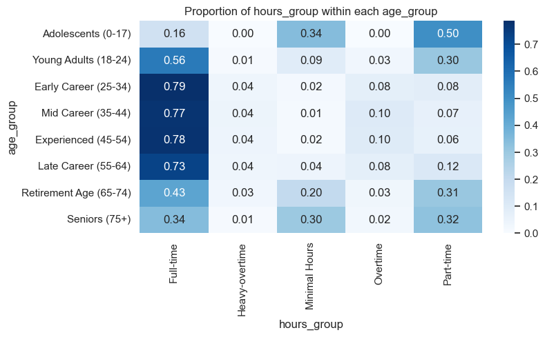
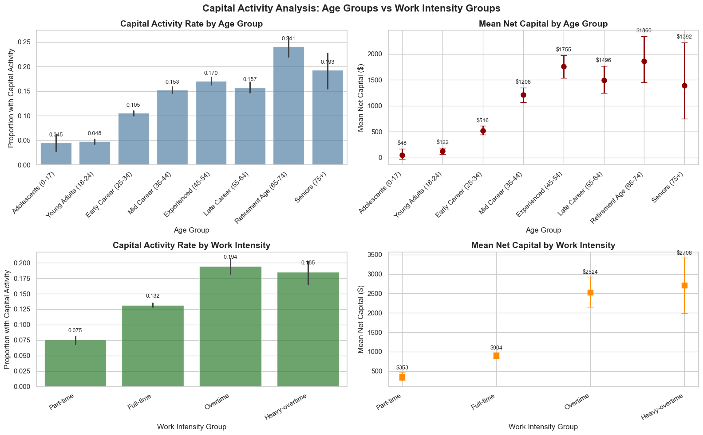
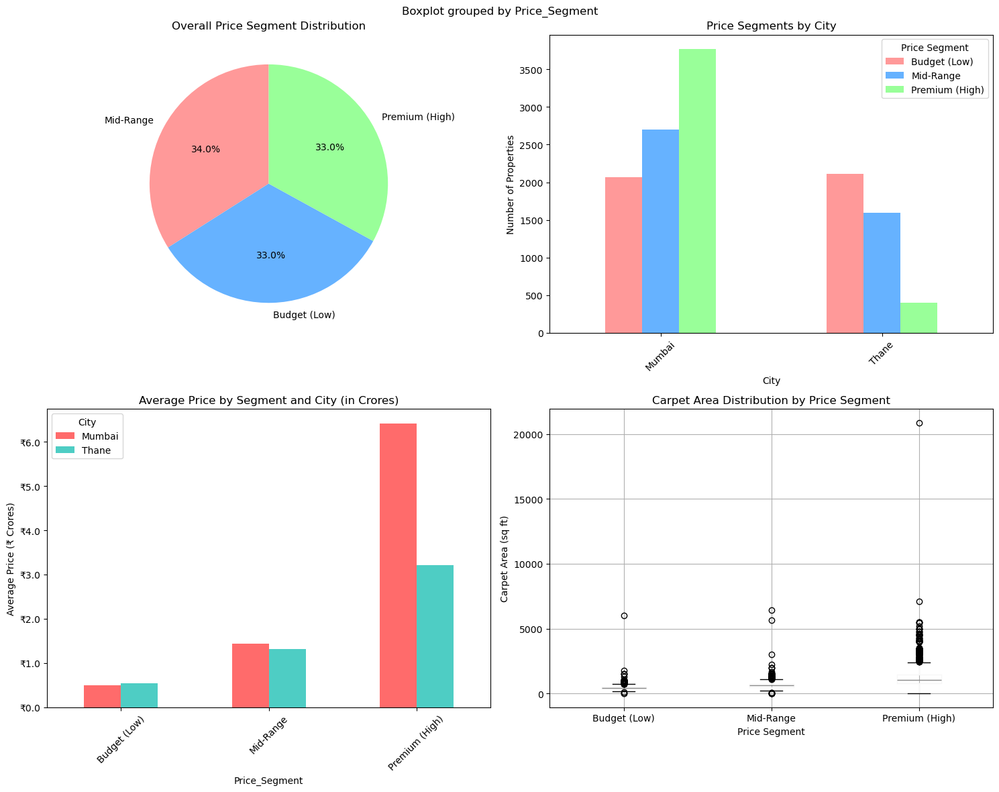
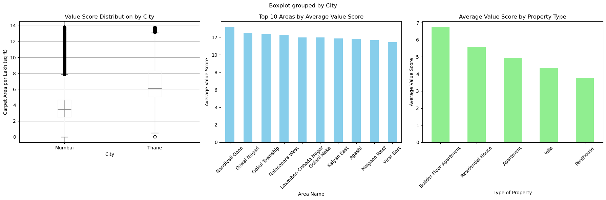
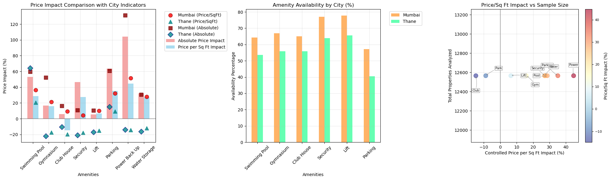
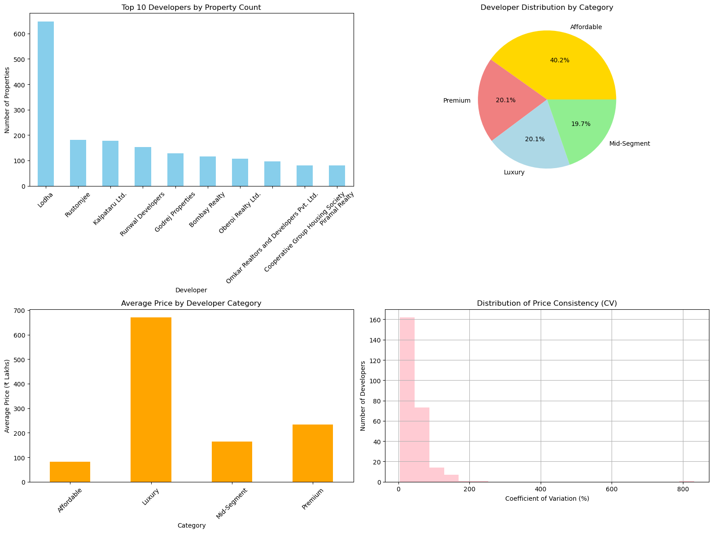

# Socio-Economic Demographics & Real Estate Investment Analytics

A modular, vectorized Python analytics suite bridging Adult Census socio-economic drivers (48,843 records) with Mumbai & Thane real estate investment intelligence (12,655 listings).

**Stack:** Python 3.10+ · Pandas · NumPy · SciPy · Statsmodels · Matplotlib · Seaborn · Pytest · GitHub Actions · GitHub Pages

## Table of Contents

- [Project Overview](#project-overview)
- [Key Analytical Highlights](#key-analytical-highlights)
- [Visual Gallery](#visual-gallery)
- [Repository Architecture](#repository-architecture)
- [Run Directly on GitHub & Cloud](#run-directly-on-github--cloud)
- [Local Quickstart](#local-quickstart)
- [Testing & Quality](#testing--quality)
- [Author & License](#author--license)

## Project Overview

Understanding financial markets starts with understanding the people who participate in them. This project combines two real-world datasets into a cohesive, production-structured analytics pipeline:

1. **Module I — Adult Census Socio-Economic & Capital Analytics (`src/analytics/census`)**
   - Cleans and engineers **48,843 demographic records** across 15 raw attributes.
   - Consolidates 17 sparse education categories into 6 ordered attainment tiers, segments continuous age into 8 career/life-stage bands, and classifies weekly work hours into employment intensity tiers.
   - Evaluates age–work relationships via **Spearman rank correlation**, **Chi-Square**, and **Cramér's V**, and models capital participation and magnitude using **Kruskal-Wallis**, **Standardized Logistic Regression**, and **Log-Linear OLS**.

2. **Module II — Mumbai & Thane Real Estate Investment Intelligence (`src/analytics/realestate`)**
   - Cleans, imputes, and analyzes **12,655 metropolitan property listings** across 145 raw columns.
   - Delivers quantile-based price segmentation, Mumbai vs. Thane comparative benchmarking, prime-location premium decomposition, **Value Score** (`sq ft per ₹ Lakh`) rankings, **size-controlled amenity valuation**, possession-timeline pricing trade-offs, and developer brand-tier consistency analysis.

3. **Cross-Domain Synthesis**
   - Maps demographic wealth-accumulation profiles (e.g., *Experienced 45–54 Postgraduate* vs. *Young Adult 18–24 Full-Time*) directly to real estate investment strategies across Mumbai and Thane.

## Key Analytical Highlights

### Module I: Adult Census Socio-Economic Findings

| Metric / Hypothesis | Verified Result | Analytical Interpretation |
| :--- | :--- | :--- |
| **Education Consolidation** | `17 -> 6` ordered tiers (`62.5%` reduction) | Eliminates tail sparsity while preserving natural career-credential ordering |
| **Age x Work Intensity** | `Spearman rho = 0.147`, `Cramér's V = 0.221` (`p < 1e-200`) | Strong inverted-U life-cycle curve; >75% of ages 25–54 work full-time |
| **Capital Market Activity** | `12.93%` active (`63.9%` net gains, `36.1%` net losses) | Average active gain `$13,062` vs. average active loss `-$1,873` |
| **Age vs. Hours (Logit β)** | **Age `β = 0.379`** vs. Hours `β = 0.265` | Life-cycle wealth accumulation is a stronger predictor of capital activity than weekly hours |
| **Peak Capital Segments** | Activity: `Retirement Age (24.1%)` · Mean Net: `$1,860` | Supports two-stage hurdle modeling (`capital_any` + `log1p(net_capital)`) |

### Module II: Mumbai & Thane Real Estate Findings

| Market Dimension | Mumbai | Thane | Strategic Investor Takeaway |
| :--- | :---: | :---: | :--- |
| **Active Listings** | `8,542` (67.5%) | `4,113` (32.5%) | Mumbai dominates luxury inventory; Thane anchors value housing |
| **Average Property Price** | `₹339.5 Lakhs` | `₹108.3 Lakhs` | Mumbai averages >3x Thane's ticket size |
| **Average Price / sq ft** | `₹28,394 / sq ft` | `₹12,437 / sq ft` | **Thane offers a 56.2% per-sq-ft cost advantage** |
| **Prime Location Premium** | `+138.8%` total (`+46.1%` / sq ft) | `+24.6%` total (`+3.3%` / sq ft) | Prime Mumbai reflects steep amenity gaps; prime Thane delivers high value |
| **Ready-to-Move Premium** | `+18.1%` | `+13.2%` | Quantifies the market price of immediate possession & zero construction risk |
| **Top Controlled Amenities** | Power Back Up (`+51.4%`), Pool (`+36.5%`) | Pool (`+20.6%`), Parking (`+9.4%`) | Size-controlled `price/sq ft` analysis isolates true amenity value |

## Visual Gallery

### Age x Work Intensity Life-Cycle Heatmap


### Capital Activity Across Age & Work Groups


### Mumbai & Thane Price Segmentation


### Value-for-Money Top Localities


### Size-Controlled Amenity Price Impact


### Developer Tiers & Pricing Consistency


## Repository Architecture

```text
socioeconomic-realestate-analytics/
├── .github/workflows/
│   ├── analytics-pipeline.yml          # GitHub Actions CI + one-click runnable pipeline & artifact upload
│   └── pages.yml                       # Automated GitHub Pages deployment for interactive report
├── data/raw/
│   ├── adult_census.csv                # 48,843 demographic & capital activity records
│   └── mumbai_thane_realestate.csv     # 12,655 metropolitan property listings
├── docs/
│   ├── index.html                      # Interactive visual showcase served via GitHub Pages
│   └── figures/                        # High-resolution analytical figures
├── notebooks/
│   ├── 01_census_socioeconomic_analysis.ipynb
│   └── 02_realestate_investment_analysis.ipynb
├── scripts/
│   └── run_pipeline.py                 # Unified CLI runner (--module all|census|realestate)
├── src/analytics/
│   ├── cli.py                          # Packaged console entry point
│   ├── config.py                       # Centralized paths, bins, mappings & domain constants
│   ├── census/
│   │   ├── preprocessing.py            # Vectorized cleaning & feature engineering
│   │   ├── analysis.py                 # Chi-square, Cramér's V, Kruskal-Wallis, Logit & OLS
│   │   └── visualization.py            # Automated chart generation
│   └── realestate/
│       ├── preprocessing.py            # Vectorized cleaning, sqft imputation & amenity parsing
│       ├── analysis.py                 # Segmentation, Value Score, controlled amenity & developer tiers
│       └── visualization.py            # Automated market chart generation
├── tests/
│   ├── test_census.py                  # Unit tests for census transformations & stats
│   └── test_realestate.py              # Unit tests for real estate parsing & valuation metrics
├── pyproject.toml
├── requirements.txt
└── LICENSE
```

## Run Directly on GitHub & Cloud

This repository is engineered to run directly from GitHub with zero local setup:

1. **GitHub Actions (One-Click Cloud Execution)**
   - Navigate to the **Actions** tab -> **Analytics Pipeline & Tests** -> click **Run workflow**.
   - Select `all`, `census`, or `realestate` to run unit tests, execute the full Python pipeline on GitHub's cloud runners, view live metrics in the **Job Summary**, and download generated charts and `analytics_summary.json` from **Artifacts**.
2. **GitHub Pages (Live Interactive Visual Showcase)**
   - Enable **Settings -> Pages -> Source: GitHub Actions** to publish `docs/index.html` as a live interactive dashboard.
3. **GitHub Codespaces**
   - Click **Code -> Codespaces -> Create codespace on main**, then run `pip install -r requirements.txt && python scripts/run_pipeline.py`.

## Local Quickstart

```bash
# 1. Create a virtual environment and install dependencies
python3 -m venv .venv
source .venv/bin/activate
pip install -r requirements.txt

# 2. Run the full modular analytics pipeline
python scripts/run_pipeline.py --module all --output-dir outputs

# Or run an individual module without regenerating plots
python scripts/run_pipeline.py --module census --skip-plots
python scripts/run_pipeline.py --module realestate --skip-plots
```

Generated JSON metrics and publication-ready PNG charts are written to `outputs/`.

## Testing & Quality

All data transformations are vectorized using `pandas` and `numpy` and verified with `pytest`:

```bash
pytest -v
```

## Author & License

- **Author:** Rajath Gadagkar (`rajathgadagkar@gmail.com`)
- **License:** Released under the [MIT License](LICENSE).
